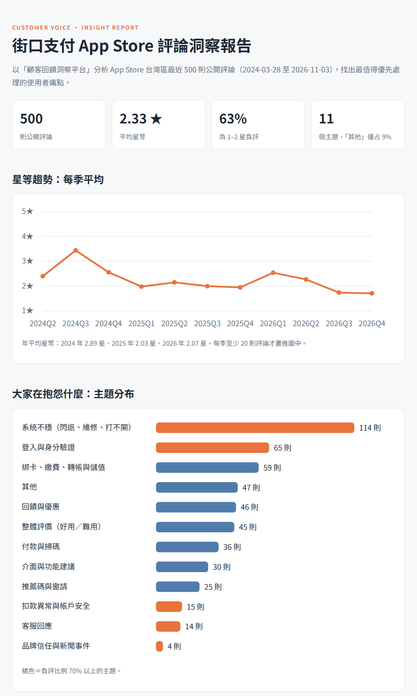
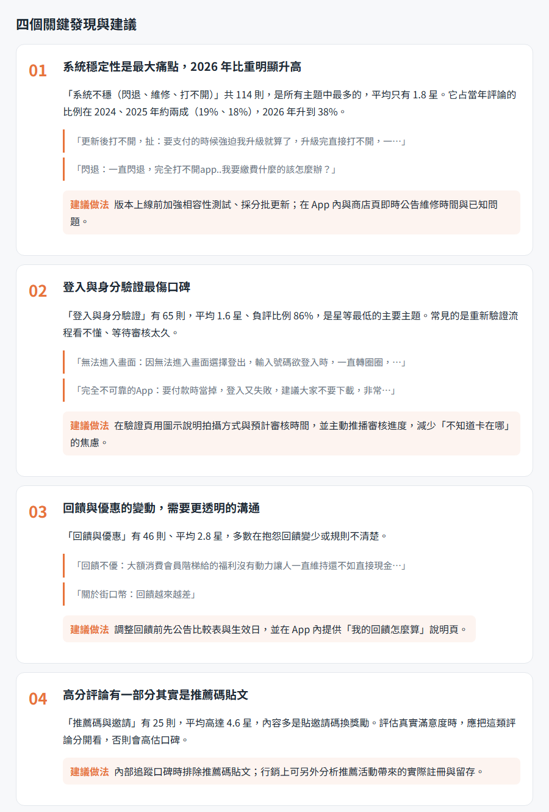
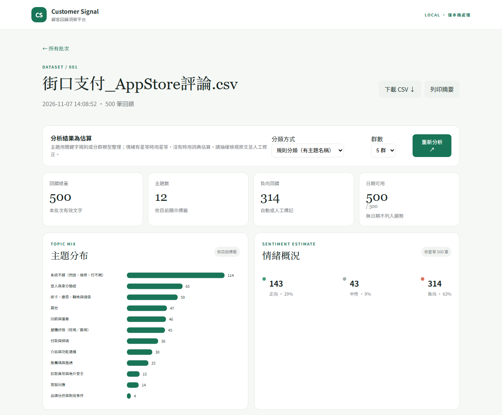

# 顧客回饋洞察平台

把一堆顧客評論，整理成「哪些問題最該先處理」的清單。

匯入評論 CSV 後，平台會自動分主題、判斷正負評、依「則數 × 負評比例 × 近期變化」排出優先順序，每個結論都能點回原始評論確認。

**實際案例：** 用平台分析街口支付 App Store 最近 500 則公開評論，整理成一頁[洞察報告](https://b3879121-rgb.github.io/feedback-insight/)。



## 洞察報告：四個關鍵發現

每個發現都附上評論摘錄與建議做法。



## 平台畫面

匯入 CSV 後的分析儀表板：主題分布、情緒概況、日期趨勢，往下還有優先排序與逐筆原文。



---

## 開發過程

先用 Codex 產生 MVP，再用 Claude Code 拿 500 則真實評論測試。測試發現兩個問題，於是逐一改善：

| 問題 | 改善前 | 改善後 |
|---|---|---|
| 情緒判斷不準 | 詞典只有 27 個詞，以星等當答案驗證只有 **37%** 正確 | 擴充詞典、處理「不好用」「不太方便」這類否定，在沒參與調整的一半資料上達到約 **70%**；有星等的資料直接用星等 |
| 主題看不懂 | 自動分群把近一半評論塞進同一群，主題只有「主題 1、主題 2」 | 新增可編輯的關鍵字規則，主題有名稱（例如「登入與身分驗證」），只有 9% 歸到「其他」；自動分群保留下來用來探索新主題 |

另外把重複的程式整理成共用函式、加上中文註解，並新增抓評論的腳本與報告產生器。

## 功能

- **匯入：** CSV 需要 `date`、`source`、`text` 欄位，`rating`（1–5 星）可選。匯入前會先預覽並列出格式有問題的列。
- **主題：** 兩種方式可選
  - 規則分類：依 `data/topic_rules.json` 的關鍵字，主題有名稱，可依產業自行修改。
  - 自動分群：jieba 斷詞 → TF-IDF → SVD → KMeans，適合找出規則沒涵蓋的新議題。
- **情緒：** 有星等用星等（1–2 星負評、3 星中性、4–5 星正評），沒有就用 `data/sentiment_lexicon.json` 的詞典判斷。
- **優先排序：** 分數 = 則數 40% + 負評比例 40% + 近 14 天成長 20%，每個分數都顯示組成，不是黑盒子。
- **人工修正：** 可以手動改主題與情緒，重新分析時會保留。
- **輸出：** 匯出 CSV、列印摘要。

## 快速開始

需要 Python 3.12。

```
py -3.12 -m venv .venv
.venv\Scripts\Activate.ps1
pip install -r requirements.txt
python app.py
```

開啟 http://127.0.0.1:5000，可以先下載首頁的模擬資料試用。

## 用真實評論做一份報告

```
python scripts/fetch_app_reviews.py 1020122239 reviews/jkopay_reviews.csv
python make_report.py reviews/jkopay_reviews.csv "街口支付"
```

第一行從 Apple 公開的評論 RSS 抓台灣區最近的評論（最多 500 則），第二行輸出 `docs/index.html`。
真實評論只存在本機的 `reviews/`，不會上傳到 GitHub；報告只摘錄片段。

## 限制

- 留評的人多半體驗特別好或特別差，分析結果不代表全體使用者。
- 詞典判斷不懂反諷，也會受到語境影響，約七成準確；重要結論請回到原文確認。
- 優先分數是排序用的參考，不代表客觀風險或商業成效。

## 隱私

資料庫與匯入的評論都存在本機 `instance/`，不會呼叫外部 AI 或分析服務。匯入前請先移除姓名、電話、電子郵件、訂單編號等個資。

## 技術

Python、Flask、SQLite、scikit-learn、jieba
